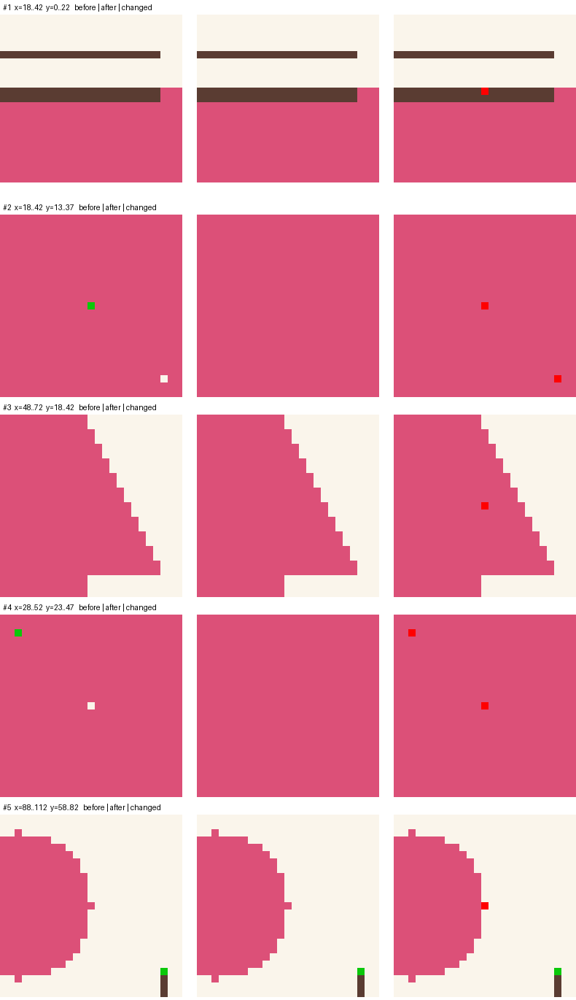

# 2027 졸업작품 PSD 자동 클린업

> **Photoshop 플러그인 1단계(연동 테스트) 설치·실행 방법: [docs/1단계_Photoshop_플러그인_설치_테스트_가이드.md](docs/1단계_Photoshop_플러그인_설치_테스트_가이드.md)**

원본 PSD/PSB를 넣으면 **어패럴 / 인테리어** 유형별 규칙으로 레이어를 검사하고, **확실한 오류만** 고친 뒤
**레이어가 그대로 유지된 새 PSD**(`원본명_CLEAN.psd`)와 검수 보고서를 만드는 로컬 프로그램입니다.

> 이 도구는 **검수 보조 도구**이며 졸업 검수 통과를 보장하지 않습니다. 보고서의 '불확실' 항목은 반드시 사람이 확인하세요.
> 모든 처리는 내 컴퓨터 안에서만 실행되고, 네트워크나 클라우드로 전송하지 않습니다.

- 원본 파일은 절대 수정하지 않습니다(저장 전후 SHA-256으로 확인).
- 출력 PSD는 원본 파일 구조를 다시 쓰면서 **수정된 레이어의 픽셀 채널만** 교체합니다.
  레이어 이름·순서·그룹·가시성·불투명도·블렌드 모드·마스크·효과·ICC·해상도·색상 모드·캔버스 크기는 원본 바이트 그대로입니다.
- 블러, 리샘플링, 전역 침식/팽창, 안티앨리어싱 추가는 하지 않습니다. 수정은 "이미 주변에 있는 색으로 1픽셀 채우기" 또는 "투명 처리"뿐입니다.

---

## 1. 빠른 시작

### 필요 환경
- Python 3.10 이상 (macOS / Windows / Linux)
- 의존성: `psd-tools`, `numpy`, `scipy`, `Pillow` (`requirements.txt`)
- Photoshop 연동(선택): Photoshop 2023(v24) 이상 + UXP Developer Tool

### 설치
```bash
python3 -m venv .venv
source .venv/bin/activate        # Windows: .venv\Scripts\activate
pip install -r requirements.txt
```
더블클릭 실행: macOS는 `run_mac.command`, Windows는 `run_windows.bat`.
처음 실행할 때 가상환경을 만들고 의존성을 설치한 뒤 브라우저 화면을 엽니다.
※ 두 스크립트 모두 **실제 Mac/Windows에서 실행해 보지 않았습니다(미검증)**.

### 사용 방법 A — 브라우저 화면 (권장)
```bash
python -m psd_cleanup serve          # http://127.0.0.1:8765/ (이 컴퓨터에서만 접속 가능)
```
1. PSD 파일 또는 폴더 경로 입력 (여러 줄 = 여러 개 일괄 처리)
2. 유형: 어패럴 / 인테리어
3. 리핏: 상하 / 좌우 / 상하좌우 / 해당 없음
4. 어패럴: 도수, 허용 색상(선택) · 인테리어: 표현 방식(디지털 색면/수채화/색연필/크레파스), 승인 질감 레이어(선택)
5. **자동 클린업 실행** → 진행률 표시, 취소 가능, 끝나면 보고서 링크와 수정 위치 이미지 표시

### 사용 방법 B — 명령줄
```bash
# 1단계: 검수만 (수정 없음, _CLEAN.psd 는 원본과 바이트가 같은 사본)
python -m psd_cleanup inspect 작품.psd --type apparel

# 어패럴: 도수와 허용 색 지정 + 상하좌우 리핏
python -m psd_cleanup run 작품.psd --type apparel --repeat both --color-count 6 \
    --colors "#FFF9F0,#F7B6C8,#E87A9A,#FCEFB4,#CDE8F6,#8A6A5E"

# 인테리어: 수채화 프로필, 폴더 일괄 처리, 승인 질감 레이어
python -m psd_cleanup run 작품폴더/ --type interior --style watercolor --repeat horizontal --texture-layer "지무늬*"

# 프로젝트 설정 JSON 사용 (examples/*.json 참고)
python -m psd_cleanup run 작품.psd --config examples/apparel_project.json
```
옵션: `--out 출력폴더`(기본값: 입력폴더/_cleanup_output), `--recursive`, `--protect-layer "이름*"`, `--no-fix`,
`--overwrite-outputs`(이전 **결과 파일만** 덮어씀), `--save-config 설정.json`

### 사용 방법 C — Photoshop 패널 (UXP 플러그인) ⚠ 미검증
1. 터미널에서 `python -m psd_cleanup serve` 실행 (UXP는 Python을 직접 실행할 수 없어서 로컬 서버를 경유합니다)
2. **Adobe UXP Developer Tool** → *Add Plugin* → `uxp-plugin/manifest.json` 선택 → *Load*
3. Photoshop의 *플러그인 > PSD 클린업* 패널을 엽니다.
   - **레이어 읽기·대조**: Photoshop이 보여 주는 레이어 트리와 이 도구가 파일에서 읽은 트리를 비교합니다(1단계 검증).
   - **자동 클린업 실행**: 저장된 현재 문서를 처리한 뒤 `_CLEAN.psd`를 **Photoshop에서 다시 열고** 레이어 구조를 원본과 비교합니다.
4. 문서를 먼저 저장해야 합니다(디스크의 원본 파일을 기준으로 처리).

> UXP 패널은 이 개발 환경에 Photoshop이 없어 **실제 Photoshop에서 한 번도 실행하지 못했습니다.**
> 레이어 대조 로직(`uxp-plugin/compare.js`)만 Node로 단위 테스트했습니다.
> 확인이 필요한 항목: manifest v5 로드, `http://127.0.0.1` 네트워크 권한, `getEntryWithUrl` + `app.open`, `executeAsModal`, Spectrum UI 위젯 값 읽기.

---

## 2. 출력 파일

| 파일 | 내용 |
|---|---|
| `원본명_CLEAN.psd` | **기본으로 이 파일 하나만 생성**합니다. 아래 보고서·이미지는 `--with-report` / 화면의 "보고서·비교 이미지도 만들기"를 켰을 때만 생성. |
| (결과 PSD) | 레이어가 유지된 결과 PSD (PSB 입력이면 `.psb`). 저장 후 검증에 실패하면 `_VERIFY_FAILED.psd`로 이름을 바꿈 |
| `원본명_QA.html` | 요약, 유형별 집계, 저장 후 검증 결과, 레이어 목록(수정 가능 여부), 검출 항목 전체(수정/보존/검토 필요), 비교 이미지 |
| `원본명_QA.json` | 자동화용 구조화 로그. 모든 검출 항목에 `type, layer_id, bounds, confidence, evidence, proposed_action, changed_pixel_count` 포함 |
| `원본명_DIFF.png` | 수정된 픽셀 위치 (빨간 점 + 원) |
| `원본명_FIXES.png` | 수정 지점별 **수정 전 / 수정 후 / 변경 표시** 10배 확대 비교 |
| `원본명_repeat_preview.png` | 리핏 연결 미리보기 (좌우 3×1, 상하 1×3, 상하좌우 3×3). 빨간 테두리는 불연속 후보 |
| `원본명_BGCHECK.png` | (인테리어) 검정/흰색/파랑 배경 위 합성. 위: 원본, 아래: 결과. 지우개 흔적 확인용 |

신뢰도 등급: **확실**(자동 수정) · **불확실**(수정 안 함, 사람 확인) · **의도적**(보호 목록/통과 사례와 일치, 변경 금지) · **지원 불가**(변경 금지) · 정보



---

## 3. 검수 규칙 구현 현황

> 기준 PDF는 처음에는 첨부되지 않아 명세서 표를 기준으로 구현했고, 이후 받은 **PDF 페이지 사진(2·4·6·8·10·11·12쪽 화면)**과
> 대조해 빠진 규칙을 추가했습니다. 쪽 번호는 받은 화면의 표시(n/12) 기준입니다. 사례는 같은 성질의 합성 픽셀 패턴으로 재현해 테스트했으며,
> **PDF 속 실제 이미지 파일로 직접 실행한 것은 아닙니다**(사진 속 이미지는 해상도가 낮은 스크린샷).

### 어패럴 엔진 (`psd_cleanup/engines/apparel.py`)
| 쪽 | 기준/사례 | 구현 | 자동 수정 | 상태 |
|---|---|---|---|---|
| 기준 | 원픽셀의 점 | 연결 성분 1~4px + 다른 픽셀과의 간격 + 반복 판정 | 1~2px, 간격 ≥3px, 반복 아님, 레이어에 이런 점이 20개 미만일 때만 | 구현·테스트 |
| 기준 | 사용한 브러시와 달라 보이는 선 | — | — | **미구현** |
| 기준, 6 | 도수는 맞지만 경계에 여러 색 | 허용 색 입력 시: 허용 색 밖 픽셀 성분이 '이웃한 두 허용 색 사이의 혼합색'일 때만 가장 가까운 이웃 허용 색으로. 미입력 시: 색 수·희소 색 보고 | 허용 색 입력 시만 | 구현·테스트 |
| 기준 | 반투명 경계 | 반투명 픽셀 수 보고 | 안 함 | 보고만 |
| 2 | 모티프 돌려서 깨지는 부분 | ① 수평/수직 곧은 경계 위 1px 돌출·패임 ② **대각선 경계**: 경계선을 열/행 단위로 추적해, 양옆 ±7칸이 디지털 직선인데 한 칸만 1px 벗어나고 그 칸을 ±1 고치면 직선이 되는 곳 ③ 같은 색 이웃 1~2개뿐인 톱니 픽셀 (원·곡선 꼭짓점, 선 끝, 뾰족한 모서리는 제외) | 예 | 구현·테스트 / 2px 이상 크게 어긋난 톱니는 미구현 |
| 4 | 1픽셀씩 잘못 칠해진 부분 | ① 8이웃이 모두 같은 색인데 가운데만 다름 ② **경계 위 이물 픽셀**: 자기 색이 8이웃에 없고 한 색이 5개 이상 → 그 색 ③ 1px 구멍 | 예 (색 256개 이하 평면색 레이어) | 구현·테스트 |
| 4 | 의도가 아닌 것 같은 가는 쐐기(여러 px) | — | — | **미구현** (의도 구분 불가) |
| 6 | 통과: 의도한 1픽셀 (다른 오리 2·3에도 동일) | 같은 7×7 주변이 반복되면 의도적(주변 구조가 있으면 복제본, 단색 면이면 정확한 등간격일 때만). **점묘처럼 후보가 밀집한 영역(반경 12px에 5개 이상)은 자동 수정 보류** | 보존 | 구현·테스트 |
| 6 | 컬러 분판 틀림 | 분판 구조 자동 감지 + 레이어 간 픽셀 이동 수정(위 '분판 모드'). `one_color_per_layer` 설정 시: 레이어별 복수 색, **같은 색이 여러 레이어에 흩어짐**, 레이어 수 ≠ 도수 | 안 함 | 보고만·테스트 |

### 인테리어 엔진 (`psd_cleanup/engines/interior.py`)
| 쪽 | 기준/사례 | 구현 | 자동 수정 | 상태 |
|---|---|---|---|---|
| 기준, 10 | 점(지무늬·배경 포함), 배경에 덜 지워진 부분 | 불투명 고립 점 (비슷한 점 3개 이상이면 지무늬로 보존) | 디지털: 1~2px, 간격 ≥3px / 수채화·색연필·크레파스: 안 함 | 구현·테스트 |
| 기준, 8, 10 | 다른 배경색 시 지저분한 지우개 흔적 | 몸체와 떨어진 반투명 성분 + 검정·흰색·파랑 배경 합성 이미지(위: 원본 / 아래: 결과) | 디지털: 최대 alpha ≤40 / 수채화 등: alpha ≤16, 간격 ≥6px, 200px 이하 | 구현·테스트 |
| 8 | 도장툴·스팟툴 사용 후 정리 안 한 부분 | 외곽 2px 띠 안의 작은 이질 점(주변보다 확연히 어둡거나 밝음) | 안 함 | 보고만·테스트 |
| 8 | 외곽 매끄럽게 정리 안 된 부분 | 대부분 부드러운 외곽인 레이어에서 딱딱한 계단 외곽이 몰린 구간 | 안 함 (외곽을 새로 그려야 함) | 보고만·테스트 |
| 8 | 정리 안 된 직선 자국 | 양옆과 다른 1px 세로/가로 직선이 24px 이상 | 안 함 | 보고만·테스트 |
| 기준 | 밝은 컬러가 여백처럼 / 구멍 | 닫힌 작은 투명 구멍(2~64px) 보고, 1px 구멍은 디지털만 채움 | 1px만 | 구현·테스트 |
| 기준 | 스캔 모티프의 배경이 외곽에 남음 | 외곽 종이색 띠 / 꽉 찬 스캔 레이어 | 안 함 | 보고만·테스트 |
| 기준 | 주변 그림체와 달라 보이는 선 | — | — | **미구현** |
| 8 | 모티프 리핏 안 맞음 | 캔버스 끝 이음매 연속성 (아래 '리핏') | 안 함 | 보고만·테스트 |
| 10 | 지무늬 리핏 안 맞음 | **캔버스 안쪽 타일 이음매**: 무늬가 한 직선에서 일제히 잘려 생기는 '짧은 곧은 경계 구간'이 유독 많은 열/행 (스트라이프·점선·테두리 제외) | 안 함 (이음매 ±2px의 1픽셀 수정도 보류) | 보고만·테스트, 검출률 낮음(아래) |
| 11 | 통과: 교수와 상의한 의도적 질감 (외곽·배경 정리는 필수) | `approved_texture_layers`: 내부 검사 제외, 외곽·잔여 검사는 유지 | — | 구현·테스트 |
| 12 | 통과: 수채화·번짐은 지우개 다르게 | 표현 방식별 프로필, 몸체에 붙은 반투명 번짐은 탐지 대상 아님 | — | 구현·테스트 |

### 분판 모드 (어패럴, 자동 감지) — 실제 분판 PSD 테스트 후 추가
- 레이어가 **한 색씩, 반투명 없이, 서로 겹치지 않는** 분판 구조이면 자동으로 켜집니다(`separation_mode: "auto"`).
- 레이어를 따로 고치면 분판 사이에 구멍·겹침이 생깁니다(실제 PSD에서 구멍 93px, 겹침 49px 발생 확인). 그래서 분판 전체를 하나의 색 지도로 검사하고, 1픽셀을 고칠 때는 **원래 분판 레이어에서 빼서 새 색 분판 레이어로 옮깁니다.**
- 저장 후 검증에 **분판 구멍·겹침 수가 원본과 같은지**를 추가했습니다(다르면 실패 처리).

### 반복된 1픽셀도 고치기 (`fix_repeats`, 기본 꺼짐)
- 기본값에서는 모티브 복제본마다 똑같이 있는 1픽셀을 PDF 6쪽 기준에 따라 '의도적 반복'으로 보존합니다.
- 보고서에서 그것이 **복사된 실수**로 보이면 이 옵션을 켭니다(화면 체크박스 / `--fix-repeats`). 1픽셀 이물·구멍·경계 돌기만 대상이며, 점선·도트 같은 반복 점무늬, 곡선 꼭짓점, 밀집 영역은 여전히 보존합니다.

### 실제 작품 테스트: 28SS5-A002KGY03.psd (어패럴, 4200×3600, 7도수 분판)
| 항목 | 결과 |
|---|---|
| 구조 | 레이어 7개 = 색 7개, 반투명 0, 겹침 0, 구멍 0 → 분판 모드 |
| 기본 모드 | 자동 수정 2px (1px 홈, 1px 톱니) |
| `fix_repeats` | 자동 수정 27px (복제본마다 반복된 분홍 1px 점, 1px 돌기·홈 포함). 27곳 모두 확대 확인 |
| 보고만 | 곡선 꼭짓점 1px 3곳 |
| 리핏(상하좌우) | 문제 없음. 깅엄 경계가 캔버스 끝과 일치해 생기던 오탐 14건을 고침(같은 무늬가 디자인 다른 곳에도 있으면 정상 연결로 판정) |
| 검증 | 원본 해시 불변, 레이어 구조·태그 블록·리소스 바이트 동일, 분판 구멍/겹침 0→0, 색 7개 유지 |
| 처리 시간 | 약 2분 |
| 미검증 | 결과 PSD를 Photoshop에서 열어 보기 |

### 스캔 종이 배경 지우기 (인테리어, `remove_paper`, 기본 꺼짐)
- 화면 체크박스 "스캔 종이 배경 지우기" 또는 `--remove-paper`. 종이색은 자동 추정(또는 `--paper-color`).
- 바깥과 이어진 종이 → 투명. 꽃잎 안쪽처럼 **물감에 둘러싸인 둥근 흰 부분은 유지**, 줄기 사이에 갇힌 **길쭉한 종이 띠는 제거**.
- 모티브 외곽 3px은 물감 농도로 반투명 + 종이색을 걷어내는 색 보정 → 다른 바탕색 위에서 **흰 종이 테두리가 남지 않음**(수채 번짐 유지).
- 종이 가장자리의 테두리선·작은 먼지는 제거. 안쪽에 떨어진 가는 선(줄기/꽃술일 수도 있음)은 **지우지 않고 '확인 필요'로 보고**.
- 옅은 물감(흰 꽃잎의 회색 음영 등)은 종이 질감보다 진하고 진한 물감과 이어져 있으면 모티브로 유지.
- 테스트: 합성 스캔 + 사용자가 준 '완성 예시' 이미지를 종이 위 스캔처럼 되돌려 다시 지운 뒤 비교 → 정답과의 평균 차이 5.79 → 0.82 (0~255). 외곽선·음영이 전혀 없는 순백 부분은 종이와 구분 불가(한계). 실제 PSD로는 **아직 미검증**.

### 공통
- **리핏**: 레이어 단위와 병합 이미지 단위로 모두 검사합니다. 양끝 픽셀이 같은지만 보지 않고, `[끝-2, 끝-1 | 0, 1]` 네 줄의 국소 연속성을 비교합니다(이음매 차이가 양쪽 내부 변화보다 훨씬 큰 구간). 2×2, 3×3 타일 미리보기도 만듭니다. **자동 수정은 하지 않습니다.**
- **레이어 점검**: 숨김, 기본 이름("레이어 1" 등), 빈 레이어, 클리핑, 효과를 보고합니다. 자동 삭제는 하지 않습니다.
- **보호**: `protected_layers`(이름 glob, 절대 수정 안 함), `protected_regions`(캔버스 좌표 영역, 레이어 지정 가능), `approved_texture_layers`
- **안전장치**: 한 레이어의 변경이 `max(64px, 0.5%)`를 넘으면 그 레이어의 수정을 전부 취소합니다. 어패럴에서 수정 결과에 기존에 없던 색이 생겨도 취소합니다. 같은 픽셀을 건드리는 수정이 겹치면 뒤의 수정을 건너뜁니다.
- 사용자가 입력하지 않은 도수·색·허용치·교수 협의 사항은 추정하지 않습니다. 기본 임계값은 이 도구의 보수적 기본값일 뿐 공식 기준이 아닙니다.

---

## 4. 지원 범위

| 구분 | 검사 | 자동 수정 |
|---|---|---|
| PSD(v1), PSB(v2) | ✅ | ✅ (PSB는 테스트 파일 없음 → **미검증**) |
| RGB 8bit, Grayscale 8bit | ✅ | ✅ |
| 16/32bit, CMYK, Lab, Indexed, Bitmap, Duotone | 구조 정보만 | ❌ 원본 사본 저장 + '지원 불가' 보고 |
| 일반 픽셀 레이어, 그룹 내 레이어, 숨김 레이어, 블렌드 모드/불투명도/클리핑/레이어 효과가 있는 레이어 | ✅ | ✅ (효과는 픽셀을 따라 다시 계산됨) |
| 레이어 마스크/벡터 마스크가 있는 레이어 | ✅ (픽셀 채널 기준) | ❌ 마스크와 결합한 결과를 수정하는 기능 미지원 |
| 잠긴 레이어 (투명·픽셀·전체 잠금) | ✅ | ❌ |
| 텍스트, 셰이프, 스마트 오브젝트, 조정/칠 레이어 | 목록만 | ❌ 원본 그대로 |
| 병합(미리보기) 이미지 | ✅ (리핏·색 수 검사에 사용) | 수정된 위치만 차이(delta) 반영 |

---

## 5. 검증 현황 (이 개발 환경에서 실제 실행한 것)

### 자동 테스트 — `python -m pytest tests` → **57개 전부 통과** (모의 Photoshop 기반 플러그인 1단계 흐름 테스트 3개 포함)
명세서 5장 항목별 대응:

| # | 테스트 | 결과 |
|---|---|---|
| 1 | 원본 보존: 실행 전후 SHA-256 동일, 출력 경로가 원본이면 거부, 기존 결과 덮어쓰기 거부 | 통과 |
| 2 | PSD 유효성: psd-tools와 Pillow(독립 파서)로 다시 열기, 수정 없는 왕복 저장이 바이트 동일 | 통과 / **Photoshop 재열기: 미검증** |
| 3 | 레이어 불변성: 수정하지 않은 레이어의 압축 채널 바이트 동일, 태그 블록·마스크·이미지 리소스 바이트 동일, 이름·순서·가시성·불투명도·블렌드 모드·경계·그룹 동일, 한글 레이어 이름 유지 | 통과 |
| 4 | 색상: 허용 색 밖 새 색 0개, 혼합색은 이웃한 허용 색으로, 설명되지 않는 색 블록은 수정 안 함 | 통과 |
| 5 | 형태: 1px/2px 선, 3px 막대의 둥근 끝, 계단형 대각선, 삼각형 꼭짓점, 원, 꽃술형 줄기 끝, 반투명 번짐 → 변경 0px (두 엔진 모두) | 통과 |
| 6 | 리핏: 이음매 없는 타일 0건, 깨진 타일 검출(레이어+합성), 방향 설정 준수, 미리보기 생성 | 통과 |
| 7 | 유형 분리: 같은 PSD에서 어패럴은 경계 돌출/패임 수정, 인테리어는 반투명 잔여 제거 | 통과 |
| 8 | 예외: 5쪽 반복 1px, 등간격 격자, 점 질감, 11쪽 승인 질감, 보호 레이어·영역, 12쪽 수채화 프로필 | 통과 |
| 9 | 회귀: 위 전체 + 평가 중 발견한 문제(같은 결함이 흩어져 있으면 반복으로 오인하던 문제, 원 꼭짓점 오인)의 회귀 테스트 | 통과 |
| 10 | 오탐: 결함 없는 합성 디자인에서 변경 0px, 깨끗한 대각선 경계 변경 0px | 통과 |
| — | 기준 PDF 사례 재현: 2쪽 대각선 톱니, 4쪽 계단 위 이물 픽셀, 6쪽 점묘 밀집 보존·분판 불일치, 8쪽 외곽 이질 점·계단 외곽·직선 자국, 10쪽 내부 타일 이음매(스트라이프 오탐 없음) | 통과 |
| — | 잠금/16bit/Grayscale/변경량 한도/배치 실패 격리/취소/설정 JSON/로컬 서버 API(헤더·Host 검사, 작업 실행, 파일 제공 제한)/UXP 대조 로직(Node) | 통과 |

### 결함 주입 평가 — `tools/eval_injected.py` (첨부 디자인 이미지 2100×1800 기준)
깨끗한 디자인을 레이어 PSD로 만든 뒤, 위치를 아는 결함을 유형별로 10개씩 넣고 측정했습니다. **합성 결함에 대한 수치일 뿐 실제 검수 정확도가 아닙니다.**

| 시나리오 | 주입 → 정확히 복원 | 주입 외 변경 |
|---|---|---|
| 어패럴 (12도수 평면색으로 변환) | 1px 잘못 칠함 10/10, 1px 구멍 10/10, **고립 점 0/10** | 1,341px (0.035%) — PDF 대조 후 대각선 톱니·경계 이물 픽셀 규칙 추가로 197px에서 증가 |
| 인테리어 · 디지털 (부드러운 외곽 모티브) | 옅은 잔여 5/5, 불투명 점 3/10 | 63px (0.002%) |
| 인테리어 · 수채화 | 옅은 잔여 5/5, 불투명 점 0/10 (설계상 보고만) | 0px |
| 원본 디자인 그대로 (JPEG 연속톤) · 두 엔진 | — | **0px** |
| 10쪽 내부 이음매 (보고 전용) | 점무늬 타일: 세로 7/10, 가로 3/10 · 실제 이미지에 만든 이음매: 1/6 · 이음매 없는 타일·실제 이미지 오탐: 0 | — |

해석:
- 어패럴 고립 점 0/10: 변환한 디자인에 원래 '설명되지 않는 1px 점'이 21개 있어서, 여기에 주입한 10개를 더하면 31개가 됩니다. 20개 이상이면 질감으로 보고 일괄 삭제를 막는 보호(명세: "고립 픽셀 일괄 삭제 금지")가 작동했습니다. 31개는 모두 '불확실'로 보고됩니다.
- 주입 외 변경 1,341px / 63px: 양자화·알파 추출로 생긴 1px 잡티였습니다(곡선·대각선 외곽의 1px 톱니, 거의 같은 두 크림색 사이의 1px, 옅은 종이 먼지). 확대 샘플 23건(1차 8건, PDF 대조 후 15건)을 눈으로 확인했으며 모티브 형태가 망가진 사례는 없었습니다. 이것을 '오탐'으로 볼지는 실제 통과 PSD와 비교해야 판단할 수 있습니다.
- 실제 졸업작품 **불통 원본 + 통과 클린업본 PSD 쌍**이 생기면 `tools/eval_pairs.py`로 픽셀 단위 정밀도·누락·오탐을 측정할 수 있습니다(도구는 동작 확인함, 실제 쌍 데이터 없음).

### 미검증 / 미구현 요약
- **미검증**: Photoshop에서 결과 PSD 열기, 실제 Photoshop이 저장한 PSD(테스트 PSD는 psd-tools로 생성), PSB, UXP 플러그인 전체, Mac/Windows 실행 스크립트, 대용량 파일(테스트한 가장 큰 파일 2100×1800 · 2레이어: 약 6~55초 (평면색 레이어에서 경계 추적 검사가 돌 때 가장 느림))
- **미구현**: 브러시/그림체와 다른 이질적 선 탐지, 2px 이상 크게 어긋난 톱니·여러 픽셀짜리 쐐기 보정, 반투명 경계 경화, 마스크 있는 레이어 수정, 리핏 자동 수정, 지무늬 재생성, 스캔 종이색 외곽 자동 제거, 레이어·영역 타일링 처리(현재는 레이어 단위로 메모리에 올림), 생성형 AI(사용하지 않음)

---

## 6. 폴더 구조
```
psd_cleanup/
  psd_io.py        PSD 읽기 / '수정 레이어 채널만 교체' 쓰기 / 병합 이미지 delta 갱신
  analysis.py      규칙 기반 탐지기 (고립 점, 1px 이상, 경계 돌출·패임, 허용 색, 구멍, 종이색 외곽, 리핏 연속성, 반복 판정)
  engines/
    apparel.py     어패럴 엔진 (판정·수정 허용 범위 별도)
    interior.py    인테리어 엔진 (표현 방식별 보호 프로필)
  repeat.py        리핏 검사 + 타일 미리보기
  pipeline.py      분석 → 수정 → 안전검사 → 저장 → 재검증 → 보고서, 배치/취소/실패 격리
  verify.py        저장 후 재검증 (해시·구조·바이트·픽셀)
  report.py        QA.html / DIFF / FIXES / BGCHECK
  server.py, ui.html  127.0.0.1 전용 로컬 서버 + 브라우저 화면
  cli.py           명령줄
uxp-plugin/        Photoshop UXP 패널 (manifest v5, index.js, compare.js)
tests/             pytest (psd_factory.py = 테스트 PSD 생성기)
tools/             eval_injected.py(결함 주입 평가), eval_pairs.py(골든 쌍 평가), make_sample.py
examples/          샘플 PSD 3개 + 프로젝트 설정 JSON 예시
```

## 7. 개발 단계 현황
| 단계 | 내용 | 상태 |
|---|---|---|
| Phase 1 | PSD 읽기·레이어 목록·레이어별 검사·QA 보고서 (`inspect`) | 완료 (Photoshop 레이어 대조는 미검증) |
| Phase 2 | 안전한 자동 수정 + 별도 PSD 저장 + 레이어 보존·재열기 검증 | 완료 (psd-tools/Pillow 재열기) |
| Phase 3 | 어패럴 엔진 | 1차 구현 (이질적 선, 대각 톱니 미구현) |
| Phase 4 | 인테리어 엔진 | 1차 구현 (종이색 외곽은 보고만, 이질적 선 미구현) |
| Phase 5 | 리핏 보고 + 배치 + 실패 격리 | 완료 (리핏 수정은 의도적으로 미지원) |
| Phase 6 | UI·진행률·취소·패키징 | 브라우저 UI 완료, UXP 패널 작성(미검증), 실행 스크립트(미검증) |

## 8. 다음에 필요한 것
1. 테스트할 **Photoshop 버전과 OS** → UXP 패널을 실제로 로드해 검증
2. 실제 졸업작품 **불통/통과 PSD 쌍** → `tools/eval_pairs.py` 골든셋, 임계값 조정
3. 주로 쓰는 레이어 종류(마스크, 스마트 오브젝트 등) → 마스크 레이어 수정 지원 여부 결정
4. 기준 PDF 원본 → 쪽별 사진과 규칙 대조
